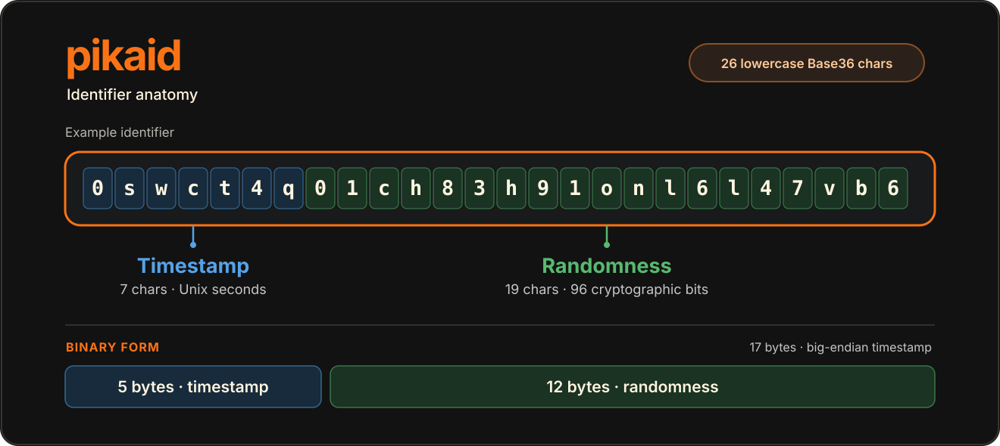

<p align="center">
  
</p>


# pikaid — canonical specification

<p align="center"><strong>Small · Sortable · Secure IDs</strong></p>

**Specification revision:** `1.0.4` · **Identifier format:** immutable · **Alphabet:** lowercase Base36

pikaid is a compact, chronologically sortable identifier for databases, APIs, and distributed systems. Each identifier is **26 lowercase Base36 characters**: a **7-character Unix timestamp** (seconds) followed by **19 characters encoding 96 bits of cryptographic randomness**. An equivalent **17-byte binary representation** is available for efficient storage.

The identifier format is deliberately simple and stable. **Specification revisions describe and clarify that same format; they do not version or change the identifiers.**

- **Canonical specification:** this repository.
- **Official implementations:** See the [pikaid GitHub organization](https://github.com/pikaid) for the current list of official implementations.

## 1. Identifier anatomy



A pikaid consists of two fixed-width, big-endian unsigned values:

| Field      | String offsets |         String width | Binary offsets | Binary width | Meaning                                    |
| ---------- | -------------: | -------------------: | -------------: | -----------: | ------------------------------------------ |
| Timestamp  |          `0–6` |  7 Base36 characters |          `0–4` |      5 bytes | Unix seconds since `1970-01-01T00:00:00Z`  |
| Randomness |         `7–25` | 19 Base36 characters |         `5–16` |     12 bytes | Uniform cryptographic randomness (96 bits) |
| **Total**  |     **`0–25`** |    **26 characters** |     **`0–16`** | **17 bytes** |                                            |

The permitted alphabet, in ascending digit order, is:

```text
0123456789abcdefghijklmnopqrstuvwxyz
```

Each numeric component is encoded in Base36, left-padded with `0` to its fixed string width. Uppercase characters, separators, prefixes, suffixes, and checksums are **not** part of the format.

### 1.1 Representable ranges

| Component  | Inclusive minimum |                                   Inclusive maximum |
| ---------- | ----------------: | --------------------------------------------------: |
| Timestamp  |               `0` |                         `36^7 − 1 = 78,364,164,095` |
| Randomness |               `0` | `2^96 − 1 = 79,228,162,514,264,337,593,543,950,335` |

The maximum timestamp corresponds to **4453-04-05 15:21:35 UTC**. Although five bytes can represent timestamps up to `2^40 − 1`, values above `36^7 − 1` are **not valid pikaid timestamps**.

Likewise, 19 Base36 characters can represent values exceeding 96 bits. Such suffixes are **not valid pikaid randomness values**, even when their length and alphabet are correct.

## 2. Normative language and format rules

The key words **MUST**, **MUST NOT**, **REQUIRED**, **SHOULD**, **SHOULD NOT**, and **MAY** are interpreted as described in [RFC 2119](https://www.rfc-editor.org/rfc/rfc2119) and [RFC 8174](https://www.rfc-editor.org/rfc/rfc8174) **only when they appear in uppercase**.

A compliant implementation:

1. **MUST** generate exactly 26 ASCII characters from `[0-9a-z]`, with a seven-character timestamp prefix and a nineteen-character randomness suffix.
2. **MUST** encode both components as unsigned, fixed-width, lowercase Base36 strings with left-zero padding; it **MUST NOT** truncate values or silently normalize nonconforming input.
3. **MUST** use the whole-second Unix timestamp in UTC, within `0..36^7 − 1`; timestamps before the Unix epoch or after the representable maximum **MUST NOT** be generated.
4. **MUST** obtain **12 bytes of uniformly distributed random data** from a cryptographically secure random number generator (CSPRNG). Non-cryptographic generators such as `rand()`, `mt_rand()`, and `Math.random()` **MUST NOT** be used for normal generation.
5. **MUST** support the exactly 17-byte binary representation and lossless, reversible conversion between the string and binary forms.
6. **MUST** reject invalid input to strict decoding and conversion operations rather than truncate, wrap, or coerce it.

An implementation **MAY** provide convenience APIs, such as generation with a caller-supplied timestamp or database helpers, provided they preserve the format and its validation rules. Caller-supplied timestamps **MUST** still be range-checked, and production generation **MUST** still use a CSPRNG.

## 3. Generation and conversion

### 3.1 Generate a string

1. Read the current Unix time as an integer number of seconds.
2. Reject the timestamp unless `0 ≤ timestamp ≤ 78,364,164,095`.
3. Encode that timestamp in lowercase Base36 and left-pad to **7 characters**.
4. Obtain **12 random bytes** from a CSPRNG; interpret them as an unsigned **96-bit big-endian** integer.
5. Encode that integer in lowercase Base36 and left-pad to **19 characters**.
6. Concatenate the two strings, without punctuation or separators.

### 3.2 Generate or decode binary

The binary representation is exactly `BINARY(17)`:

```text
[ 5-byte unsigned timestamp, big-endian ][ 12 randomness bytes, unchanged ]
```

- Bytes `0–4` encode the same Unix timestamp as the seven-character prefix, as an unsigned big-endian integer.
- Bytes `5–16` are exactly the original 12 randomness bytes, including any leading zero bytes.
- A binary decoder **MUST** reject a buffer whose length is not 17 bytes, or whose timestamp exceeds `36^7 − 1`.
- String-to-binary conversion **MUST** reject a randomness component whose decoded value exceeds `2^96 − 1`.
- Conversion **MUST** preserve both fields bit-for-bit. For valid input, `fromBinary(toBinary(id)) = id`, and `toBinary(fromBinary(bytes)) = bytes`.

Neither representation contains a format version byte or a version marker. Specification revision numbers are **not encoded** in the identifier.

## 4. Validation and parsing

A string is a **valid pikaid** if and only if all the following hold:

1. Its length is **exactly 26 ASCII bytes/characters**.
2. Every character belongs to `[0-9a-z]` (an exact whole-string match, not merely a partial regex match).
3. Its first seven characters decode to a timestamp in `0..36^7 − 1`.
4. Its final nineteen characters decode to an unsigned integer in `0..2^96 − 1`.

These conditions are stricter than merely checking the shape of a string. A format-only or *well-formedness* helper **MAY** check just length and alphabet, but it **MUST NOT** describe that result as full validity.

- A boolean validation predicate **MAY** return `false` for invalid values.
- Strict parsing and conversion operations **MUST** report invalid values as errors (for example, by raising an exception); they **MUST NOT** silently accept them.
- A parser **MUST** preserve the timestamp at full integer precision and the randomness as the original 12 bytes or an equivalent 24-character lowercase hexadecimal value.
- The canonical conceptual names are **`timestamp`** and **`randomness`**. Language-specific APIs **MAY** provide compatibility aliases, but they do not change these field definitions.
- If a datetime object is returned, it **MUST** represent the decoded timestamp in UTC.

## 5. Ordering and storage

Fixed-width Base36 encoding makes the timestamp prefix lexicographically ordered by numeric timestamp. The big-endian binary representation has the same ordering property.

**Guarantee:** for two valid pikaid values with *different* timestamps, the value with the earlier timestamp sorts first, in both representations, under unsigned bytewise / ASCII-compatible lexicographic comparison.

**Non-guarantee:** two identifiers generated during the **same second** are ordered by their random suffix, **not** by the order in which they were generated. pikaid is therefore **not a monotonic sequence generator**, and its timestamp has **one-second precision**.

For database storage:

| Representation | Recommended column                                    | Comparison requirement                              |
| -------------- | ----------------------------------------------------- | --------------------------------------------------- |
| Binary         | `BINARY(17)` or an equivalent fixed-width binary type | Unsigned bytewise comparison                        |
| Text           | `CHAR(26)` / `VARCHAR(26)`                            | Binary or other verified ASCII-compatible collation |

Database default collations are **not automatically safe** for bytewise ordering and equality. For example, on MariaDB/MySQL, use an appropriate binary collation for the text form rather than relying on a case-insensitive or punctuation-insensitive default. Database-specific column definitions remain the responsibility of individual implementations.

## 6. Security and collision properties

- Each generated suffix contains **96 bits of CSPRNG randomness**, representing **`2^96 ≈ 7.92 × 10^28`** possible random values.
- The *encoding space* of nineteen Base36 characters is larger: **`36^19 ≈ 3.71 × 10^29`** strings. Most of those strings are **outside** the valid 96-bit range; they are not additional randomness states.
- For `n` independent identifiers generated **with the same timestamp**, an approximate collision probability is `1 − exp(−n(n−1) / (2 × 2^96))`. The approximately **50% collision threshold** is **`3.31 × 10^14`** identifiers within one timestamp bucket.
- Identifiers with *different encoded timestamps* cannot be identical. Randomness reduces collision probability within a second; **it does not guarantee uniqueness**. Applications **SHOULD** enforce uniqueness where required, for example with a database primary key or unique constraint.
- The timestamp is readable from an identifier. pikaid values are **not secrets**, authentication tokens, or substitutes for authorization checks.
- No checksum is present. A transcription mistake can still produce another valid identifier; applications requiring error detection **SHOULD** validate references against their actual data.

## 7. Interoperability examples

These examples illustrate the exact, fixed-width encoding. They do not depend on a particular programming language.

| String identifier            | Timestamp (seconds) | Randomness (12 bytes, hex) | Binary representation (17 bytes, hex) | Result                              |
| ---------------------------- | ------------------: | -------------------------- | ------------------------------------- | ----------------------------------- |
| `00000000000000000000000000` |                 `0` | `000000000000000000000000` | `0000000000000000000000000000000000`  | Valid                               |
| `00000010000000000000000001` |                 `1` | `000000000000000000000001` | `0000000001000000000000000000000001`  | Valid                               |
| `zzzzzzz7oiylpimjg5u2ca1ypr` |       `78364164095` | `ffffffffffffffffffffffff` | `123ede3fffffffffffffffffffffffffff`  | Valid                               |
| `0000000zzzzzzzzzzzzzzzzzzz` |                   — | —                          | —                                     | Invalid: randomness exceeds 96 bits |

For valid rows, the 34-digit hexadecimal value represents **exactly 17 bytes**: the first 10 hex digits encode the five-byte big-endian timestamp, and the remaining 24 hex digits are the unchanged randomness bytes. These are known-answer examples, not a complete conformance test suite.

A 17-byte binary value with timestamp `0xffffffffff` (for example, `ffffffffff000000000000000000000000`) **MUST** also be rejected: it exceeds the string-format timestamp maximum. Other invalid inputs include uppercase letters, missing/extra characters, non-Base36 characters, and binary buffers not exactly 17 bytes long.

Implementations **SHOULD** test these boundaries, known-answer conversions, malformed inputs, and randomized round trips across their supported environments. Normative shared machine-readable conformance vectors can be published separately without changing the identifier format.

## 8. Design rationale

- **Compact:** 26 characters, the same character count as ULID and shorter than the conventional hyphenated 36-character UUID representation.
- **Sortable:** a fixed-width timestamp prefix enables chronological ordering at **one-second granularity** without an auxiliary timestamp field, under the stated comparison rules.
- **Secure randomness:** 96 CSPRNG-generated bits, compared with ULID's 80 random bits. Randomness improves resistance to accidental collisions and guessing, but it does not make an identifier an access-control mechanism.
- **Portable:** a standard lowercase Base36 alphabet, no punctuation, and a reversible 17-byte binary representation.
- **Deliberately minimal:** no separators, checksums, monotonic counters, or embedded format versions. These omissions are part of the immutable design, not missing implementation features.

Performance depends on language, runtime, hardware, optional big-integer extensions, and benchmark methodology. Implementation-specific measurements belong with the relevant implementation, rather than being presented as universal guarantees of this specification.

## 9. Specification revisions

**The pikaid identifier format is immutable and unversioned.** Only the *specification document* is revised. Specification revisions **MUST NOT** alter the pikaid identifier format, its alphabet, field widths, timestamp resolution, randomness budget, encoding, binary mapping, ordering semantics, or the set of valid identifiers. Revisions **MAY** clarify existing requirements, correct documentation errors, and improve interoperability guidance without changing the format.

| Revision          | Scope                                                        |
| ----------------- | ------------------------------------------------------------ |
| `1.0.4`           | Clarifies validation limits, binary and string interoperability, ordering, security claims, and documentation; restores MIT licensing for the specification. The identifier format is unchanged. |
| `1.0.3`           | Licensing/documentation revision; the identifier format was unchanged. |
| Earlier revisions | Historical wording and implementation guidance for the same identifier format. |

Consumers may pin a specific Git commit of this repository for a reproducible normative reference. A future incompatible identifier design would require a separate, explicitly identified format rather than a reinterpretation of existing pikaid values.

## 10. License and contact

This specification and its accompanying materials are licensed under the **[MIT License](LICENSE)**. Independent implementations may be distributed under their own applicable licenses.

For project and licensing inquiries: [larananas.dev@proton.me](mailto:larananas.dev@proton.me).
